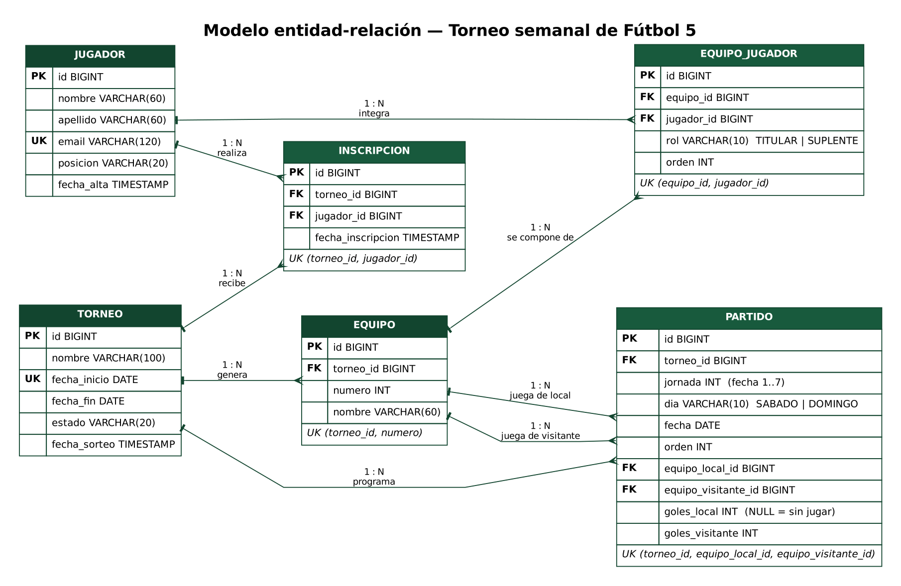
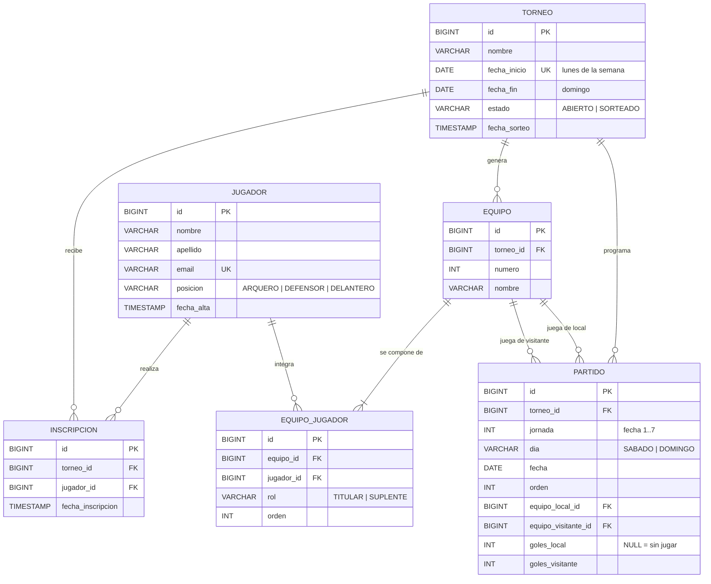

# Modelo de datos — Torneo semanal de Fútbol 5

Documento para el informe del Taller Integrador.

> La imagen `der.png` se genera desde `der.dot` con Graphviz (`dot -Tpng docs/der.dot -o docs/der.png`).
> Abajo está el mismo diagrama en Mermaid, que GitHub, GitLab, Notion y VS Code muestran como gráfico.

## Entidades y relaciones

| Relación | Cardinalidad | Significado |
|---|---|---|
| Jugador — Inscripción | 1 : N | Un jugador puede anotarse en muchos torneos (uno por semana). |
| Torneo — Inscripción | 1 : N | Un torneo recibe muchas inscripciones. |
| Jugador ↔ Torneo | N : M | Resuelta por la tabla intermedia **INSCRIPCION**. |
| Torneo — Equipo | 1 : N | El sorteo de un torneo genera varios equipos. |
| Equipo — Equipo_Jugador | 1 : N | Un equipo tiene 5 titulares y 0 o más suplentes. |
| Jugador — Equipo_Jugador | 1 : N | Un jugador integra un equipo por cada torneo en que juega. |
| Equipo ↔ Jugador | N : M | Resuelta por la tabla intermedia **EQUIPO_JUGADOR**, que además guarda el rol. |
| Torneo — Partido | 1 : N | El fixture de un torneo tiene n·(n−1)/2 partidos (28 con 8 equipos). |
| Equipo — Partido (local) | 1 : N | Un equipo figura como local en varios partidos. |
| Equipo — Partido (visitante) | 1 : N | Un equipo figura como visitante en varios partidos. |

La **tabla de posiciones no es una tabla de la base de datos**: es un dato derivado que se calcula cada vez a partir de los resultados guardados en PARTIDO. Guardarla aparte sería redundante y podría quedar desactualizada respecto de los resultados.

## Diccionario de datos

### JUGADOR
| Columna | Tipo | Restricciones | Descripción |
|---|---|---|---|
| id | BIGINT | PK, autoincremental | Identificador |
| nombre | VARCHAR(60) | NOT NULL | Nombre |
| apellido | VARCHAR(60) | NOT NULL | Apellido |
| email | VARCHAR(120) | NOT NULL, UNIQUE | Identifica a la persona entre semanas |
| posicion | VARCHAR(20) | NOT NULL, CHECK | ARQUERO, DEFENSOR o DELANTERO |
| fecha_alta | TIMESTAMP | NOT NULL | Primera vez que se registró |

### TORNEO
| Columna | Tipo | Restricciones | Descripción |
|---|---|---|---|
| id | BIGINT | PK | Identificador |
| nombre | VARCHAR(100) | NOT NULL | Ej.: "Torneo semanal del 19/10 al 25/10/2026" |
| fecha_inicio | DATE | NOT NULL, UNIQUE | Lunes de la semana (garantiza un torneo por semana) |
| fecha_fin | DATE | NOT NULL, CHECK ≥ fecha_inicio | Domingo de la semana |
| estado | VARCHAR(20) | NOT NULL, CHECK | ABIERTO (acepta inscripciones) o SORTEADO |
| fecha_sorteo | TIMESTAMP | NULL | Momento del último sorteo |

### INSCRIPCION
| Columna | Tipo | Restricciones | Descripción |
|---|---|---|---|
| id | BIGINT | PK | Identificador |
| torneo_id | BIGINT | FK → torneo.id | Torneo |
| jugador_id | BIGINT | FK → jugador.id | Jugador |
| fecha_inscripcion | TIMESTAMP | NOT NULL | Orden de llegada |
| | | UNIQUE (torneo_id, jugador_id) | Nadie se anota dos veces en la misma semana |

### EQUIPO
| Columna | Tipo | Restricciones | Descripción |
|---|---|---|---|
| id | BIGINT | PK | Identificador |
| torneo_id | BIGINT | FK → torneo.id | Torneo al que pertenece |
| numero | INT | NOT NULL | 1, 2, 3… |
| nombre | VARCHAR(60) | NOT NULL | Color de pechera: "Equipo Rojo", "Equipo Azul"… |
| | | UNIQUE (torneo_id, numero) | |

### EQUIPO_JUGADOR
| Columna | Tipo | Restricciones | Descripción |
|---|---|---|---|
| id | BIGINT | PK | Identificador |
| equipo_id | BIGINT | FK → equipo.id | Equipo |
| jugador_id | BIGINT | FK → jugador.id | Jugador |
| rol | VARCHAR(10) | NOT NULL, CHECK | TITULAR o SUPLENTE |
| orden | INT | NOT NULL | Orden dentro del equipo (el arquero titular es el 1) |
| | | UNIQUE (equipo_id, jugador_id) | |

### PARTIDO
| Columna | Tipo | Restricciones | Descripción |
|---|---|---|---|
| id | BIGINT | PK | Identificador |
| torneo_id | BIGINT | FK → torneo.id | Torneo |
| jornada | INT | NOT NULL | Número de fecha (ronda): 1 a 7 con 8 equipos |
| dia | VARCHAR(10) | NOT NULL, CHECK | SABADO o DOMINGO |
| fecha | DATE | NOT NULL | Día calendario del partido |
| orden | INT | NOT NULL | Orden dentro de la fecha |
| equipo_local_id | BIGINT | FK → equipo.id | Primer equipo del cruce |
| equipo_visitante_id | BIGINT | FK → equipo.id | Segundo equipo del cruce |
| goles_local | INT | NULL, CHECK ≥ 0 | Goles del local; NULL mientras no se juega |
| goles_visitante | INT | NULL, CHECK ≥ 0 | Goles del visitante |
| | | UNIQUE (torneo_id, equipo_local_id, equipo_visitante_id) | Un cruce no se repite |

Todas las claves foráneas usan `ON DELETE CASCADE`: al borrar un torneo se borran sus inscripciones, equipos y partidos; al anular un sorteo se borran los partidos, los equipos y sus integrantes.

## Reglas de negocio

1. **Un torneo por semana.** Se crea automáticamente (lunes a domingo, hora de Argentina) la primera vez que alguien entra.
2. **Inscripción única.** El email identifica al jugador. Si vuelve otra semana se reutiliza su registro y se actualizan nombre y posición. No puede anotarse dos veces en la misma semana (HTTP 409).
3. **Mínimo para sortear:** 10 inscriptos (2 equipos de 5). Con menos, el sorteo responde HTTP 422 indicando cuántos faltan.
4. **Equipos** = inscriptos ÷ 5 (división entera), con un **máximo de 8 equipos por sorteo**. Cada uno tiene exactamente 5 titulares.
5. **Suplentes:** los inscriptos que no completan un equipo quedan como suplentes, repartidos parejo entre los equipos. Nadie queda afuera.
   Ejemplo: 23 inscriptos → 4 equipos + 3 suplentes (tres equipos con 1 suplente).
6. **Cupo:** 48 inscriptos por semana, es decir 8 equipos con 1 suplente cada uno. El jugador 49 recibe "cupo completo" (HTTP 409).
7. **Equilibrio por posición:** un arquero por equipo cuando alcanzan; defensores y delanteros repartidos parejo (diferencia máxima de 1 entre equipos). Si un equipo queda sin arquero, el sistema lo advierte.
8. **Cierre de inscripciones:** al sortear, el torneo pasa a SORTEADO y no acepta inscripciones ni bajas. El organizador puede volver a sortear (reemplaza equipos, fixture y resultados) o anular el sorteo (vuelve a ABIERTO).
9. **Formato de juego:** liga todos contra todos a una rueda, jugada el sábado y el domingo de la semana. Las fechas se reparten mitad y mitad (la primera mitad, redondeando para arriba, el sábado). Con cantidad impar de equipos, en cada fecha uno queda libre.

   | Equipos | Fechas | Partidos | Sábado | Domingo |
   |---|---|---|---|---|
   | 8 | 7 | 28 | fechas 1 a 4 (16 partidos) | fechas 5 a 7 (12 partidos) |
   | 6 | 5 | 15 | fechas 1 a 3 | fechas 4 y 5 |
   | 4 | 3 | 6 | fechas 1 y 2 | fecha 3 |
   | 2 | 1 | 1 | fecha 1 | sin partidos |

10. **Puntaje:** partido ganado 3 puntos, empatado 1, perdido 0. Gana el torneo el que suma más puntos cuando se jugaron todos los partidos.
11. **Desempate** (criterio de la tabla anual de la Liga Profesional de AFA, sin la tabla de fair play porque el torneo no registra tarjetas): 1) diferencia de gol, 2) goles a favor, 3) sorteo. Si el primer puesto queda igualado en todo, el sistema lo informa y el campeón se define por sorteo.

## Algoritmo de sorteo (resumen)

Implementado en `src/main/java/com/torneo/futbol5/sorteo/SorteadorEquipos.java`.

1. **Separar y mezclar:** se arman tres listas (arqueros, defensores, delanteros) y cada una se mezcla al azar (`Collections.shuffle`, algoritmo Fisher-Yates, con `SecureRandom`).
2. **Repartir en ronda (round-robin):** se recorre arqueros → defensores → delanteros y se asigna cada jugador al equipo siguiente (E1, E2, …, En, E1, …). El cursor arranca en un equipo al azar y no se reinicia al cambiar de posición, así los totales por equipo difieren como máximo en 1.
3. **Titulares y suplentes:** dentro de cada equipo, el arquero es titular y luego se alternan defensor / delantero hasta completar 5. Los que no entran quedan como suplentes.
4. **Persistir:** `SorteoService` guarda los equipos (tabla EQUIPO) y sus integrantes (EQUIPO_JUGADOR) en una sola transacción y marca el torneo como SORTEADO.

Complejidad: O(n), donde n es la cantidad de inscriptos.

## Algoritmo del fixture (método del círculo)

Implementado en `src/main/java/com/torneo/futbol5/fixture/GeneradorFixture.java`.

1. Si la cantidad de equipos es impar, se agrega un lugar vacío ("libre"): quien lo enfrenta descansa esa fecha.
2. Se ubican los equipos en dos filas y se cruzan los que quedan enfrentados. El primero queda fijo y los demás giran una posición por fecha.
3. Después de n−1 giros, cada par de equipos se cruzó exactamente una vez y nadie jugó dos veces en la misma fecha.
4. `PartidoService` guarda los partidos (tabla PARTIDO) en la misma transacción del sorteo.

## Tabla de posiciones

Implementada en `src/main/java/com/torneo/futbol5/tabla/CalculadoraTabla.java`. Recorre los partidos con resultado y acumula, para cada equipo, PJ, PG, PE, PP, GF y GC. Calcula DG = GF − GC y Pts = 3·PG + 1·PE. Después ordena por puntos, diferencia de gol y goles a favor. Las filas que quedan igualadas en los tres criterios se marcan para sorteo.
